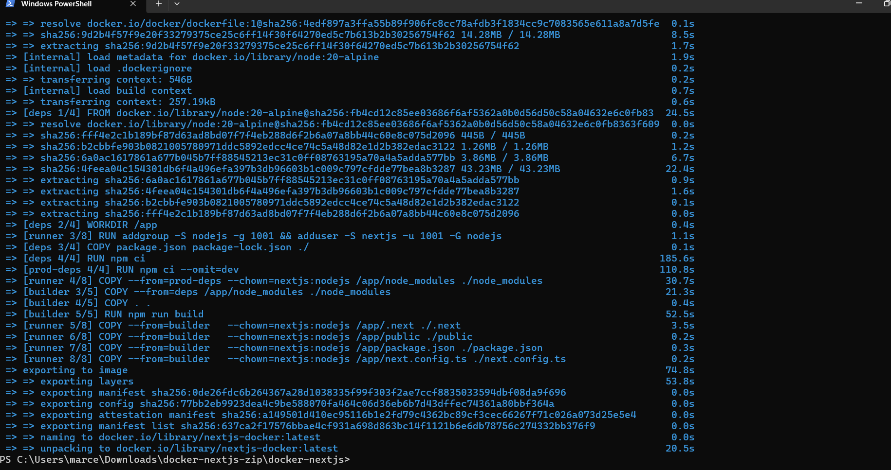
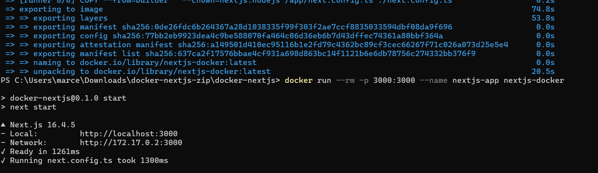
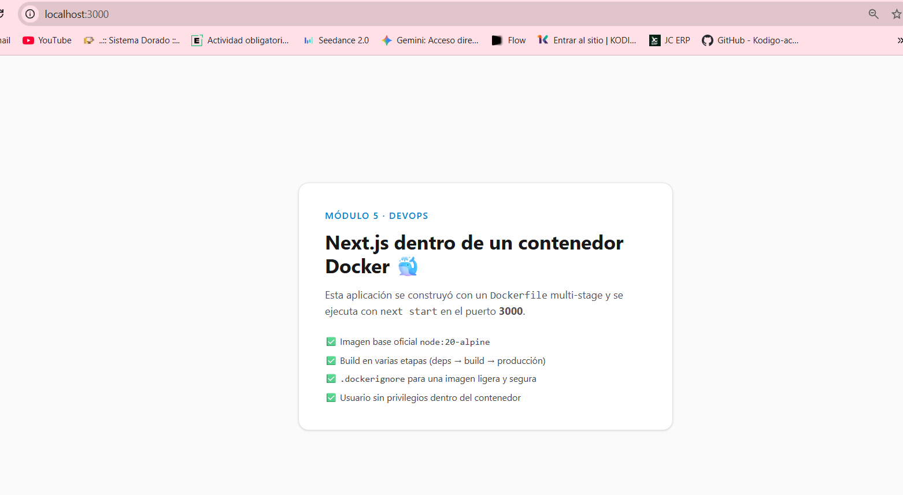

# Next.js en Docker 🐳

Proyecto **Next.js 16** (App Router, TypeScript, Tailwind) creado con `create-next-app` y contenerizado con **Docker** usando un *multi-stage build*.

> Práctica — Módulo 5: DevOps, Integración y Validación Profesional (Semana 17, KODIGO Bootcamp Full Stack Junior).

## Requisitos

- [Docker Desktop](https://www.docker.com/products/docker-desktop/) instalado y **abierto** (que el motor esté corriendo).
- No necesitas Node.js instalado para correrlo en contenedor.

## Construir la imagen

```bash
docker build -t nextjs-docker .
```

## Ejecutar el contenedor

```bash
docker run --rm -p 3000:3000 --name nextjs-app nextjs-docker
```

Luego abre <http://localhost:3000>.

`-p 3000:3000` publica el puerto del contenedor en tu máquina (`puerto-host:puerto-contenedor`). Para correrlo en segundo plano usa `-d`.

## Comandos útiles

```bash
docker ps                      # contenedores activos
docker logs nextjs-app         # ver los logs
docker stop nextjs-app         # detener
docker rm nextjs-app           # eliminar (no hace falta si usaste --rm)
docker images                  # imágenes locales
```

## ¿Qué hace el Dockerfile?

| Etapa | Qué hace |
|---|---|
| `deps` | Instala **todas** las dependencias con `npm ci` (necesarias para compilar). Se cachea mientras no cambie `package*.json`. |
| `builder` | Copia el código y ejecuta `next build`. |
| `prod-deps` | Instala **solo** las dependencias de producción (`npm ci --omit=dev`). |
| `runner` | Imagen final: copia `.next`, `public` y las dependencias de producción, crea un usuario sin privilegios, expone el puerto **3000** y arranca con `npm start` (`next start`). |

Ventajas del multi-stage: la imagen final no contiene el código fuente ni las herramientas de compilación, por lo que es más ligera y segura.

### Imagen base

Se usa `node:20-alpine`. El enunciado menciona `node:18-alpine`, pero **Next.js 16 requiere Node ≥ 20.9**, así que Node 18 no puede compilar ni ejecutar esta versión.

## `.dockerignore`

Excluye `node_modules`, `.next`, `.env*` (secretos), `.git` y archivos temporales. Así el contexto de build es pequeño, las capas se cachean mejor y no se filtran credenciales dentro de la imagen.

## Desarrollo sin Docker

```bash
npm install
npm run dev        # http://localhost:3000
```

## Capturas

Guarda tus capturas en `docs/` y se verán aquí:





> Nota: se usa la fuente del sistema (en lugar de Google Fonts) para que `docker build` no dependa de acceso a internet durante la compilación.
